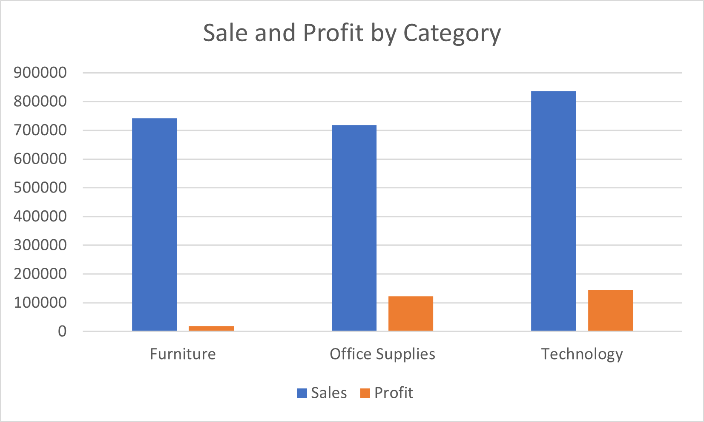

## Key Finding
Technology had the highest sales ($836,154.03) and profit ($145,454.95).
| Category | Sales | Profit | Average Discount |
|---|---:|---:|---:|
| Furniture | $741,999.80 | $18,451.27 | 17.39% |
| Office Supplies | $719,047.03 | $122,490.80 | 15.73% |
| Technology | $836,154.03 | $145,454.95 | 13.23% |
## Project Overview
Analyzed the Sample Superstore sales dataset using Python and Pandas.

## Tools Used
- Python
- Pandas
- Excel

## Key Findings
- Total Sales: $2,297,200.86
- Total Profit: $286,397.02
- Technology had the highest sales and profit among the categories.

## Project Files
- `src/load_data.py` — loads and analyzes the dataset
- `data/processed/category_summary.csv` — category sales and profit summary
- `data/processed/sales_profit_by_category.png` — category comparison chart

### Regional Performance
- West had the highest sales ($725,457.82) and profit ($108,418.45).
- South had the lowest sales ($391,721.91).
## Dataset
Download the Sample Superstore CSV dataset and place it in `data/raw/` as `Samplesuperstore.csv`.
